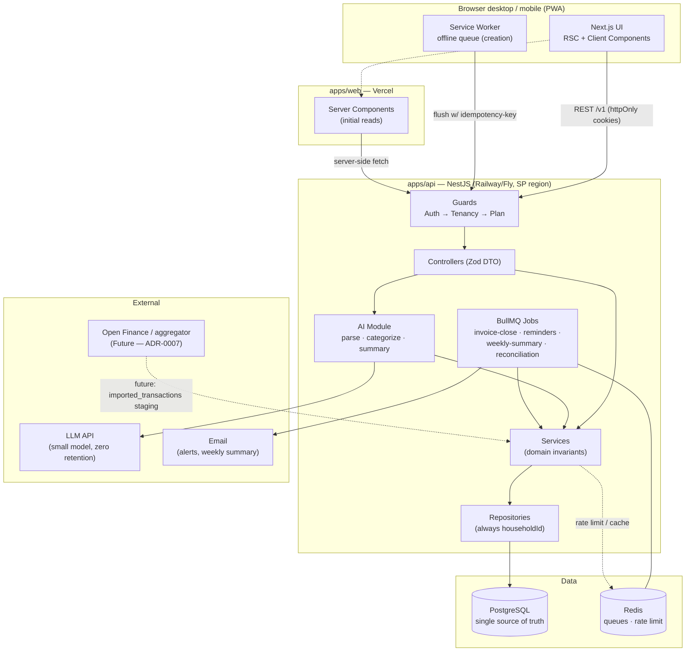
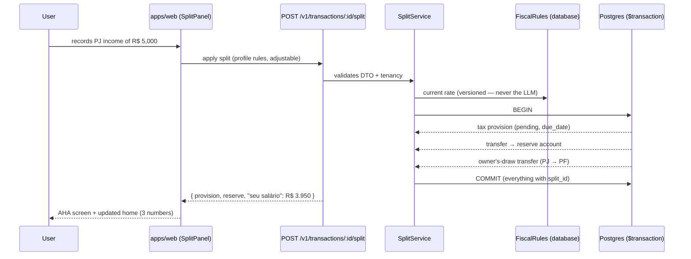
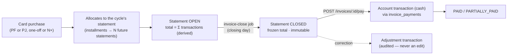
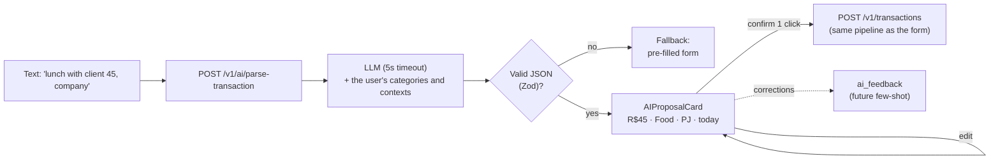

# Tally — Technical Architecture

> Perspective: Tech Lead / Staff Engineer.
> Version: 0.1 · Status: living document
> Formal decisions in `adr/` (referenced as ADR-NNNN). Detailed data model in `data-model.md`; domain in `domain-model.md`; threats in `threat-model.md`.

---

## 1. Technical architecture (overview)

Tally is made of **two applications in a monorepo** (ADR-0004): a Next.js 15 frontend (App Router) on Vercel and a NestJS API (modular monolith, ADR-0002) with PostgreSQL as the single source of truth (ADR-0003) and Redis for queues (BullMQ) and rate limiting. AI v1 is lean and proactive: natural-language parsing, categorization and weekly summary — no open chat in the MVP.

Principles:

- **The API as the single source of truth:** no authoritative state on the client. A direct anti-lesson from the benchmark (Mobills' web ≠ app divergence destroyed user trust).
- **Per-household isolation in every query** — the repository layer always receives and filters by `householdId` derived from the token, never from a client parameter (threat-model: IDOR is risk #1).
- **AI proposes, a human confirms:** the LLM never persists anything; every output is a proposal validated by a schema (Zod) that goes through the same pipeline as the manual form.
- **Numbers that add up are sacred:** balances and totals are derived (recomputable from transactions), never stored as truth; a daily reconciliation job treats divergence as an incident.
- **Graceful degradation:** an AI or Redis failure doesn't take down the core — manual entry and data reading always work.
- **Web-first with a first-class PWA** (ADR-0001): daily logging happens on the phone; responsive and the offline queue are not an afterthought.

Strategies per technology:

- **Next.js (App Router):** SSR/ISR landing (SEO is an acquisition channel) + authenticated app; Server Components for initial reads, Client Components for interaction.
- **NestJS:** REST API per domain; modules, guards (auth, tenancy, plan) and DI organize the financial domain's invariants.
- **React Query:** cache and sync of server data on the client (transaction filters, refetch after mutation).
- **Zustand:** ephemeral UI state (open entry modal, active filters, the PF/PJ context selected in the view) — never duplicate server data.
- **Prisma:** typed schema, versioned migrations, `$transaction` for split atomicity.
- **PostgreSQL 16:** ACID + invariant constraints in the database itself (CHECK account XOR invoice, etc.).
- **Redis + BullMQ:** jobs (statement closing, provision reminders, weekly summary, reconciliation); rate limit for `/ai/*`. Degradable to `@nestjs/schedule` without Redis if needed.
- **Vercel AI SDK / the provider's SDK:** LLM calls on the API (never from the browser); prompts versioned in `apps/api/src/ai/prompts`.
- **PWA:** manifest + service worker; a local queue (IndexedDB) only for offline transaction creation, with an `idempotency-key`.
- **Tests:** Vitest (unit/integration) + Playwright (E2E) + Testing Library (components).
- **Local:** Docker Compose (Postgres, Redis); a seed script with sample data (Rafael, the PJ); `.env.example`.
- **Deploy:** web on Vercel (preview per PR); API + Postgres + Redis on Railway/Fly (São Paulo region); migrations in the pipeline.

---

## 2. Folder structure (monorepo — ADR-0004)

```txt
tally/
├── apps/
│   ├── web/                        # Next.js
│   │   └── src/
│   │       ├── app/
│   │       │   ├── (marketing)/    # landing, blog (SSR/ISR, SEO)
│   │       │   ├── (auth)/         # login, sign up, onboarding
│   │       │   └── (app)/          # authenticated area
│   │       │       ├── dashboard/  transactions/  cards/
│   │       │       ├── pj/         # PJ panel, provisions
│   │       │       ├── reports/    # closed month
│   │       │       └── settings/
│   │       ├── components/
│   │       │   ├── ui/             # shadcn primitives (Button, Input, Dialog...)
│   │       │   ├── app/            # AppShell, PageHeader, MetricCard, ContextBadge
│   │       │   ├── charts/         # Recharts wrappers
│   │       │   └── feedback/       # EmptyState, LoadingState, ErrorState, Toast
│   │       ├── features/           # per domain (UI + hooks + local types)
│   │       │   ├── transactions/  split/  cards/  pj-panel/
│   │       │   ├── provisions/  reports/  ai-entry/  onboarding/
│   │       │   └── settings/
│   │       ├── lib/                # api client, money format, dates
│   │       ├── stores/             # Zustand (ui state)
│   │       └── pwa/                # service worker, offline queue
│   └── api/                        # NestJS
│       └── src/
│           ├── modules/
│           │   ├── auth/  users/  households/
│           │   ├── contexts/  accounts/  categories/
│           │   ├── cards/  invoices/          # ADR-0005
│           │   ├── transactions/  splits/  provisions/
│           │   ├── fiscal/                    # versioned fiscal_rules
│           │   ├── ai/                        # parse, categorize, summary
│           │   │   ├── prompts/  guards/  tools/
│           │   ├── insights/  reports/  exports/
│           │   └── jobs/                      # BullMQ processors + crons
│           ├── common/             # guards (tenancy!), interceptors, filters, decorators
│           └── prisma/             # PrismaService
├── packages/
│   ├── shared/                     # Zod schemas, API types, money utils (ADR-0006)
│   └── config/                     # eslint, tsconfig, prettier
├── prisma/                         # schema.prisma, migrations, seed
└── docs/                           # this documentation
```

Responsibilities:

- `apps/web/features/` — everything for a domain together; the UI doesn't call fetch directly (hooks encapsulate React Query).
- `apps/api/modules/*/service` — pure, testable business logic; receives repositories.
- `apps/api/modules/*/repository` — the only layer that talks to Prisma; **enforces `householdId` in every query**.
- `apps/api/common/guards/tenancy.guard.ts` — the most important file in the repository (threat-model).
- `packages/shared` — the same Zod schema validates on the front (RHF) and on the back (Nest pipe); shared request/response types.
- `prisma/` — the source of truth of the physical model (mirrors `data-model.md`).

---

## 3. Frontend strategy

- **Server Components:** pages and initial reads (home with the 3 numbers, transaction list on first load, closed month). No state, no effects.
- **Client Components:** the entry modal, the AI field, the split screen, filters, charts — `"use client"` on the smallest possible scope.
- **React Query:** query keys per domain + parameters (`['transactions', { month, context }]`); invalidation after mutation; optimistic update on quick entry (the 10s promise includes perception).
- **Zustand:** the active PF/PJ context in the view, open modal, AI-field draft. Filters synced to the URL (searchParams) for deep-linking.
- **Forms:** React Hook Form + Zod from `@tally/shared` (the same back-end schema — the same error on both sides).
- **Money:** always `amount_cents` (a string in the API) → formatting only at the edge with `Intl.NumberFormat` via `@tally/shared/money` (ADR-0006). A lint rule forbids `parseFloat` in a money context.
- **Keyboard shortcuts (desktop):** `N` new entry, `/` search, `Tab` flows through the form in the happy-path order.
- **Mobile/PWA:** a fixed "+" button at the thumb, a 1-column form, an offline creation queue with a sync indicator.
- **Loading/error/empty:** every fetch handles the 3 states via `components/feedback`; an empty home shows a split tutorial with disposable sample data.
- **PF/PJ visual context:** a `ContextBadge` (🟦 PJ / 🟩 PF) present on every transaction, report and number — never color as the only encoder (a11y).

---

## 4. Design system / UI foundation

| Component                              | Where                   | Type     | Main props                         | States                       | Tests            | Deps     |
| -------------------------------------- | ----------------------- | -------- | ---------------------------------- | ---------------------------- | ---------------- | -------- |
| Button                                 | `components/ui`         | generic  | variant, size, loading             | hover/focus/disabled/loading | unit             | cva      |
| Input / MoneyInput                     | `components/ui`         | generic  | error, label; cents in/out         | focus/error                  | unit             | —        |
| Select                                 | `components/ui`         | generic  | options, value                     | open/disabled                | unit             | radix    |
| Dialog                                 | `components/ui`         | generic  | open, onOpenChange                 | focus trap                   | unit a11y        | radix    |
| Tabs / SegmentedControl                | `components/ui`         | generic  | value, onChange                    | active                       | unit             | radix    |
| Toast                                  | `components/feedback`   | generic  | variant                            | auto-dismiss                 | —                | sonner   |
| EmptyState / LoadingState / ErrorState | `components/feedback`   | generic  | title, action / skeleton / onRetry | —                            | —                | —        |
| DataTable                              | `components/app`        | generic  | columns, data                      | loading/empty                | unit             | tanstack |
| DateField / MonthPicker                | `components/app`        | generic  | value, onChange                    | —                            | unit             | —        |
| AppShell / Sidebar / Topbar            | `components/app`        | product  | items, user                        | active                       | —                | —        |
| PageHeader                             | `components/app`        | product  | title, actions                     | —                            | —                | —        |
| MetricCard                             | `components/app`        | product  | label, value_cents, trend          | loading                      | unit             | —        |
| **ContextBadge**                       | `components/app`        | product  | context (PF\|PJ)                   | —                            | unit             | —        |
| TransactionAmount                      | `components/app`        | product  | cents, type                        | —                            | unit             | —        |
| ChartCard                              | `components/charts`     | generic  | title, data                        | loading/empty                | —                | recharts |
| QuickEntryModal                        | `features/transactions` | product  | defaultContext, onSaved            | submitting/error             | unit+integration | RHF+Zod  |
| AIEntryField                           | `features/ai-entry`     | product  | onProposal                         | idle/parsing/error           | unit             | —        |
| AIProposalCard                         | `features/ai-entry`     | product  | proposal, onConfirm/onEdit         | editable                     | unit             | —        |
| **SplitPanel** ⭐                      | `features/split`        | product  | income, rules, onApply             | % adjustment                 | unit+integration | —        |
| InvoiceView                            | `features/cards`        | product  | invoice                            | open/closed/paid             | unit             | —        |
| InstallmentTag                         | `features/cards`        | product  | no, of                             | —                            | —                | —        |
| PJPanel / CeilingBar                   | `features/pj-panel`     | product  | metrics / usage                    | warning ≥85%                 | unit             | —        |
| ProvisionCard                          | `features/provisions`   | product  | provision, onPay                   | pending/paid                 | unit             | —        |
| MonthCloseReport                       | `features/reports`      | product  | month                              | —                            | integration      | —        |
| InsightCard                            | `features/ai-entry`     | product  | insight, evidence                  | read/unread                  | unit             | —        |

`SplitPanel` is the most important product component (the AHA moment, hypothesis H4) — prototype and test it first.

---

## 5. Backend and API (NestJS)

- **Thin controllers:** DTO validation (a Zod pipe from `@tally/shared`), delegation to services; no rules in the route.
- **Chained guards:** `AuthGuard` (JWT from the cookie) → `TenancyGuard` (injects the token's `householdId` into the request) → `PlanGuard` (Pro features checked on the server, never only on the front).
- **Services:** pure business rules (split, statement closing, MEI ceiling); receive repositories; where the 7 invariants of `domain-model.md` live.
- **Repositories:** the only access to Prisma; the signature always starts with `householdId`.
- **Responses:** an envelope `{ data }` or `{ error: { code, message, details? } }`; domain errors mapped to HTTP; never leak stack/PII.
- **Idempotency:** `Idempotency-Key` accepted on write POSTs (safe retry of the PWA's offline queue).
- **Versioning:** the `/v1` prefix from the start.

MVP endpoints:

```txt
POST   /v1/auth/register  /v1/auth/login  /v1/auth/refresh  /v1/auth/logout
GET    /v1/me
GET    /v1/onboarding            POST /v1/onboarding        # regime, bracket, % reserve
CRUD   /v1/accounts  /v1/categories
CRUD   /v1/cards
GET    /v1/cards/:id/invoices    GET /v1/invoices/:id
POST   /v1/invoices/:id/pay
GET    /v1/transactions          # ?context=PF|PJ&month=&cursor= (cursor pagination)
POST   /v1/transactions          PATCH/DELETE /v1/transactions/:id
POST   /v1/transactions/:id/split                            # the AHA flow (atomic)
GET    /v1/provisions            POST /v1/provisions/:id/pay
POST   /v1/ai/parse-transaction  # text → proposal (doesn't persist)
GET    /v1/insights              POST /v1/insights/:id/read
GET    /v1/reports/monthly?month=   GET /v1/reports/pj-panel
GET    /v1/exports/full          # CSV/JSON, synchronous in the MVP
PATCH  /v1/settings              DELETE /v1/account          # LGPD: purge ≤30d
```

Jobs (BullMQ):

```txt
invoice-close        daily cron    closes statements whose cycle ended (closed statement = immutable)
provision-reminders  daily cron    D-7 and D-1 of pending provisions → insight + email
weekly-summary       weekly cron   aggregates the month → LLM (3 sentences) → insight + email
reconciliation       daily cron    Σ transactions vs. materialized balances → divergence = incident
account-purge        on demand     hard delete ≤30 days after account deletion
```

---

## 6. Database (Prisma + PostgreSQL)

> Full schema, indexes and derivations in `data-model.md`. Summary of the cross-cutting strategies:

- **Per-household multi-tenancy:** every domain table has `household_id` (FK, indexed) — from day 1, even with 1-person households (a cheap v2 family). The repository enforces the filter; `Decision Needed` — Postgres RLS as defense in depth in the hardening phase.
- **Money:** `bigint` cents (ADR-0006); a proportional split leaves the remainder on the last installment (invariant 5).
- **Card by statement (ADR-0005):** `invoices` as an accrual grouping; `invoice_payments` links the payment (cash); installments in N transactions via `installment_group_id`; a closed statement freezes `closed_total_cents` and becomes immutable.
- **Constraints as invariants:** `CHECK (num_nonnulls(account_id, invoice_id) = 1)` (account XOR invoice) and the like live in the database, not only in the application.
- **Derived values are never truth:** `account_balances` is a materialized view (an invalidatable cache); a daily reconciliation job compares and alerts.
- **Versioned fiscal rules:** `fiscal_rules(regime, version, valid_from, valid_to, payload)` — a rate is never hardcoded (tax reform) and **never computed by the LLM**.
- **Soft delete** with `deleted_at` on domain entities; hard delete only in the account purge (cascade).
- **Auditing:** an append-only `audit_log` (who, what, diff) for every sensitive write; `created_via` on every transaction (form|ai|import|system).
- **Prepared for the future without paying now:** Open Finance will enter as `connections` + an `imported_transactions` staging without touching the core (ADR-0007); AI v2 (chat/RAG) can add pgvector later — there are no embeddings in the MVP.

---

## 7. AI (v1 — lean and proactive)

Deliberate scope (see `mvp-scope.md`): **entry parsing, categorization and weekly summary**. No open chat, no agents, no RAG — chat enters in v1.5 with the advantage of PJ context.

- **Parsing (`POST /v1/ai/parse-transaction`):** free text ("lunch with client 45, company") + the user's categories + contexts → structured JSON. 5s timeout with a fallback to the form; the response is a **proposal**, it never persists.
- **Strict validation:** the LLM's output goes through a Zod schema identical to the form's. Invalid output = fallback, not an infinite retry.
- **Categorization with learning:** the user's corrections recorded in `ai_feedback` and used as few-shot in the following prompts (cheap personalization, no fine-tuning).
- **Weekly summary (job):** aggregations computed by SQL (never by the LLM) → the LLM only **writes** 3 sentences about ready numbers → `insights` with `evidence` (ids of the source transactions, the "numbers that add up" principle).
- **Deterministic alerts without the LLM:** provision reminder, MEI ceiling ≥85%, spend > N× the category's average — a pure rule, zero cost, total reliability. The LLM only where natural language adds value.
- **Data protection:** prompts receive the minimum (entry text, category names, aggregates) — never the full statement, email or name; `householdId` comes from the session/job, never from the prompt; a provider with zero retention/opt-out of training.
- **Prompt injection:** the user's content is clearly separated from the instructions; the LLM doesn't execute actions — it only produces validated JSON/text (`ai/guards`). `Risk`
- **Fiscal hallucination:** rates and ceilings ALWAYS come from `fiscal_rules`; the LLM is forbidden from computing taxes by prompt and by architecture (it doesn't receive the tool).
- **Cost:** a small model (Haiku class) for parsing/categorization; a per-user/day rate limit per plan; a global daily spend cap with a circuit breaker; cache of parsing for repeated patterns ("uber", "ifood"); tokens counted per user (guardrail T3). `Risk`
- **Versioned prompts** in `ai/prompts` with snapshot tests; parsing tested with fixtures (a mocked model — no cost/flakiness in CI).

---

## 8. PWA and offline

- **Installable:** manifest + icons; a discreet install prompt after the 3rd mobile use.
- **Offline queue (minimum scope):** only transaction **creation**; IndexedDB → flush with an `Idempotency-Key` on reconnect; a visible sync-status indicator.
- **Offline reads:** the last cached snapshot, marked as "stale".
- **Out of scope:** offline editing and conflict resolution (a source of bugs — anti-Wallet lesson). Editing requires a connection.
- **Notifications:** email is the reliable alert channel in the MVP (web push on iOS is limited — a trade-off accepted in ADR-0001).

---

## 9. Security and privacy

> Full model in `threat-model.md`. Operational summary:

- **Authentication:** argon2id; a short JWT (15 min) in an httpOnly+Secure+SameSite=Lax cookie; a rotating refresh token with reuse detection (revokes the family); rate limit on auth.
- **Authorization/isolation:** a global `TenancyGuard`; repositories require `householdId`; **automated IDOR tests on 100% of authenticated endpoints** — a launch gate.
- **Validation:** Zod on every input (`whitelist` — mass assignment blocked); body and pagination limits.
- **Front:** a strict CSP, HSTS; any text coming from the LLM is sanitized before rendering.
- **A closed statement is immutable** (invariant 6): a correction only via an audited adjustment transaction.
- **Rate limit:** Redis per user/IP on `/auth/*` and `/ai/*`.
- **Logs without PII:** structured (pino), `requestId` + a user hash; never transaction values or descriptions.
- **LGPD:** a full export in one click (F8); deletion with a real purge ≤30 days; minimization (no full CPF/CNPJ in the MVP — regime + bracket are enough); a policy in simple language.
- **Secrets:** provider env, out of the repository; documented rotation; Dependabot + `npm audit` in CI.
- **Backups:** an encrypted daily snapshot + **a monthly restore test as a ritual** (not just configuration).

---

## 10. Observability

- **Sentry:** front and API, releases linked to the deploy.
- **Structured logs:** JSON (pino) with `requestId`; no PII.
- **Guardrail metrics** (from `success-metrics.md`): p95 latency of the transaction CRUD (<300ms — the 10s promise), 5xx per endpoint, uptime ≥99.5%.
- **AI metrics:** tokens and cost per user/day, parse latency, the rate of proposals accepted without correction (target ≥80% after 1 month).
- **Integrity metrics:** divergences from the reconciliation job (target: zero; each case = an incident).
- **Product:** PostHog (events from `success-metrics.md`: activation, split applied, summary opened...).
- **Alerts:** errors above threshold, AI cost above the daily budget, migration failure, reconciliation divergence.

---

## 11. Tests

Value order: **domain invariants → tenancy → critical API flows → E2E of the main paths**.

- **Vitest (unit):** the 7 invariants of `domain-model.md` (split sums to zero across legs, account XOR invoice, installments sum to the total with the remainder on the last, a closed statement is immutable...); `money` utils; fiscal rules per version; validators.
- **Vitest (integration):** controllers + repositories against a test Postgres (Testcontainers/Docker); **tenancy suite: for each endpoint, user A tries to access B's resource → 404/403** — the most important test in the repository.
- **Testing Library:** `SplitPanel`, `QuickEntryModal`, `AIProposalCard`, `MoneyInput` (states and a11y).
- **Playwright (E2E):** onboarding → first expense → first income with split → home with 3 numbers; statement cycle (installment purchase → closing → payment); CSV export.
- **AI:** parsing with fixtures and a mocked model; prompt snapshots; a fallback test (timeout → form).
- **Jobs:** statement closing and reconciliation with time fixtures (fake timers).
- **A11y:** axe on the key pages and the form components.

---

## 12. CI/CD (GitHub Actions)

```yaml
jobs:
  ci:
    steps:
      - checkout
      - setup-node + pnpm (cache)
      - install (pnpm install --frozen-lockfile)
      - verify-envs (required variables present)
      - lint (eslint) + typecheck (tsc --noEmit) [turbo, per workspace]
      - unit (vitest run)
      - prisma-check (schema ⇄ migrations consistent)
      - integration (vitest, Postgres+Redis service) # includes the tenancy suite
      - build (turbo build: web + api)
      - e2e (playwright, full stack in services)
      - deploy-preview (Vercel web, on PR)
      - deploy (merge to main: migrations → api → web)
      - sentry-release
```

- Turborepo with a per-workspace cache (only builds what changed).
- Migrations applied before the API deploy (expand → contract on destructive changes).
- Preview per PR on the front; the preview API points to a seeded ephemeral database.

---

## 13. Repository documentation

- `README.md` — pitch, screenshots, stack, setup (`docker compose up` + `pnpm dev`), roadmap status.
- `CONTRIBUTING.md` — how to run, standards, PR flow. · `SECURITY.md` — how to report a vulnerability.
- `LICENSE` — `Decision Needed` (MIT if the portfolio goal wins out; evaluate before publishing, given the monetization plan).
- `.env.example` — all variables of both apps.
- `docs/` — discovery, product, ux and architecture (this document + the ADRs).

---

## Appendix A — Architecture diagram (high level)



## Appendix B — Income split flow (sequence) ⭐



## Appendix C — Statement lifecycle (ADR-0005)



## Appendix D — Natural-language entry flow


